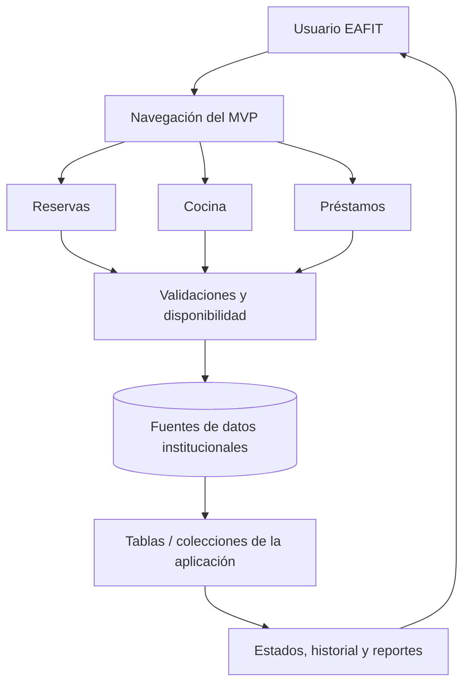
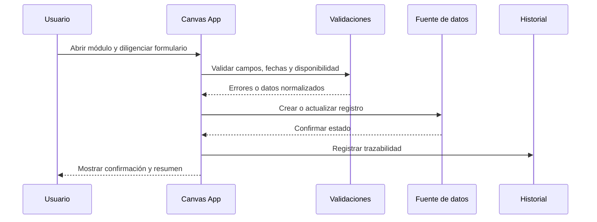
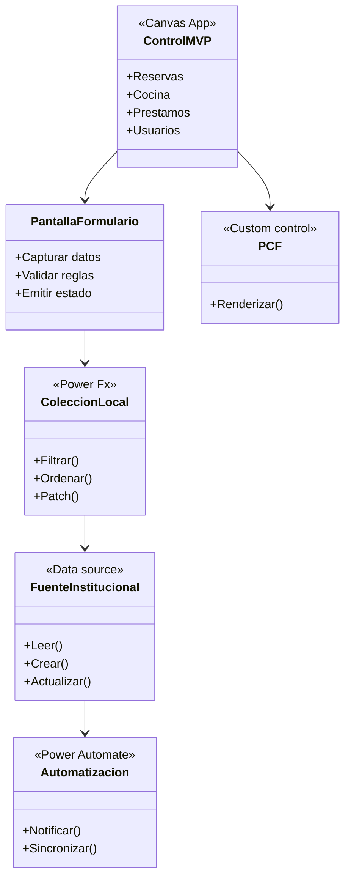

# EAFIT - Control MVP y gestión de recursos

Repositorio de trabajo para el MVP de gestión de recursos de la Escuela de Idiomas EAFIT. El snapshot combina artefactos de Power Apps Canvas, fuentes desempaquetadas para auditoría, automatizaciones, documentación de conexión y un esqueleto Flutter de apoyo.

## Qué resuelve

El MVP organiza recursos y operaciones como cocina, reservas y préstamos, con pantallas de captura, consulta y seguimiento. Los archivos `.msapp` representan la aplicación Canvas; los directorios `studio_unpacked`, `powerapps/canvas` y `powerapps/pcf` permiten revisar o reconstruir piezas técnicas cuando sea necesario.

## Arquitectura funcional



## Flujo de una operación



## UML de componentes



## Decisiones del proyecto

| Decisión | Razón | Resultado |
|---|---|---|
| Mantener `.msapp` como artefacto principal | Es el formato ejecutable de Canvas | Se conserva la aplicación que puede abrirse en Power Apps. |
| Conservar fuentes desempaquetadas | Facilita revisión, comparación y recuperación | `studio_unpacked` y `msapp_*` sirven como evidencia técnica. |
| Separar reglas de UI y fuentes de datos | Reduce errores al cambiar pantallas | Las validaciones se pueden revisar antes de publicar. |
| Usar controles PCF solo donde aportan interacción | Evita complejidad innecesaria en Canvas | Los controles personalizados quedan aislados en `powerapps/pcf`. |
| Excluir datos locales de prueba | Los XLSX/PDF pueden contener información personal o institucional | El repositorio conserva código y configuración, no copias operativas. |

## Estructura relevante

```text
Control MVP.msapp                 Aplicación Canvas principal
powerapps/canvas/                 Guías y scripts de construcción
powerapps/pcf/                    Controles personalizados
powerapps/automation/             Documentación de automatizaciones
studio_unpacked/                  Fuentes legibles de Canvas
docs/                             Guías funcionales y QA
tests/                            Pruebas y utilidades de verificación
```

## Trabajo local

Para inspeccionar el material Flutter:

```powershell
flutter pub get
flutter analyze
```

Para trabajar con Canvas se requiere Power Apps CLI (`pac`) y el entorno institucional correspondiente. Las fuentes de conexión (`.mcp.json`), datasets XLSX, PDFs y salidas generadas permanecen fuera del commit inicial por seguridad y portabilidad.

## Estado y próximos pasos

1. Confirmar en el tenant EAFIT las fuentes de datos finales.
2. Ejecutar el checklist de `powerapps/canvas/MVP_QA_CHECKLIST.md`.
3. Validar cada flujo en un ambiente de prueba antes de publicar.
4. Mantener una exportación `.msapp` versionada junto con su evidencia desempaquetada.
